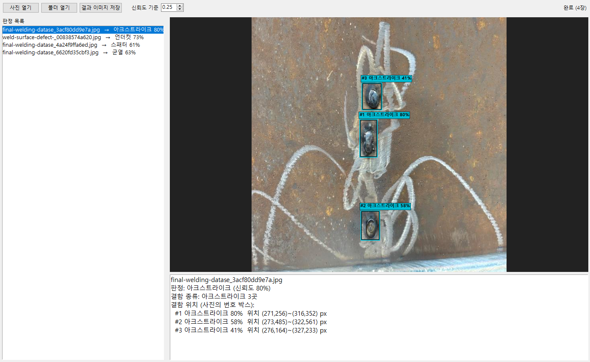

# YOLO를 이용한 용접 결함 판정 프로젝트

용접부 사진을 넣으면 **YOLO11** 객체탐지 모델이 결함 위치를 찾고 종류(9종)를 판정합니다.
현장 담당자가 바로 쓸 수 있도록 GUI 판정 프로그램을 함께 제공합니다.

- 작성자: 김인국
- 기간: 2026.10.12 ~ 2026.11.04



## 판정 대상 결함 (9종)

| id | 결함 | 라벨 | 설명 |
|---:|---|---|---|
| 0 | 용입부족 | incomplete_penetration | 용융금속의 두께가 모재두께보다 적게 용입된 상태 |
| 1 | 균열 | crack | 용접부에 금이 가는 현상 |
| 2 | 언더컷 | undercut | 용접부 부근의 모재가 용접열에 의해 움푹 패인 형상 |
| 3 | 언더필 | underfill | 용접이 덜 채워진 현상 |
| 4 | 아크스트라이크 | arc_strike | 아크 발생으로 모재 표면이 움푹 패인 현상 |
| 5 | 기공 | porosity | 가스가 빠져나오지 못하고 내부에 기포를 형성한 상태 |
| 6 | 블로홀 | blowhole | 가스가 비드 표면으로 빠져나오며 생긴 작은 구멍 |
| 7 | 스패터 | spatter | 용접 시 튄 금속 알갱이가 모재에 묻은 형상 |
| 8 | 오버랩 | overlap | 개선 절단면을 지나 모재 상부까지 용접된 형상 |

결함 기준 그림: [제출자료/assets/wD.png](제출자료/assets/wD.png)

## 폴더 구성

```
main.py                 실행 진입점 (GUI / predict / train / evaluate)
판정프로그램.bat         더블클릭으로 GUI 실행 (Windows)
weld_defect/            본체: 설정(config), 탐지·판정(detector), 학습(trainer), 평가(evaluator), GUI(app)
tools/                  데이터셋 구축, Colab 노트북·발표자료 생성 스크립트
data/sources.yaml       Roboflow 원본 데이터셋 → 9종 클래스 매핑
datasets/README.md      데이터셋 구성 설명 (이미지 자체는 저장소에 미포함)
colab_train.ipynb       Colab GPU 학습용 노트북
models/weld_best.pt     학습된 모델 (v1, YOLO11s)
reports/                val/test 평가 결과
제출자료/                제출용 PPT와 그림
```

## 설치

Python 3.10 기준입니다. GPU 학습을 하려면 CUDA에 맞는 PyTorch를 먼저 설치하세요.

```bash
python -m venv .venv
.venv\Scripts\activate
pip install -r requirements.txt
```

## 사용법

```bash
python main.py                              # GUI 판정 프로그램
python main.py predict 사진1.jpg 사진2.jpg   # 콘솔 판정
python main.py predict 사진.jpg --save       # 박스 그린 결과를 outputs/에 저장
python main.py evaluate                     # val/test 결함별 리포트 → reports/
python main.py train --epochs 80            # 학습 (datasets/ 필요)
```

## 데이터셋

Roboflow Universe의 공개 데이터셋 15개를 9종 기준으로 다시 라벨 매핑해 구축했습니다.
총 6,215장(train 4,403 / val 919 / test 893)이며, 용량 문제로 이미지는 저장소에 넣지 않았습니다.

다시 만들려면 Roboflow API 키를 환경변수로 설정한 뒤 실행합니다.

```bash
set ROBOFLOW_API_KEY=<본인 키>
python tools/build_dataset.py
```

세부 규칙(중복 제거, 유사 이미지 누수 방지, 클래스 상한 등)은 [datasets/README.md](datasets/README.md)를 참고하세요.

## 학습

로컬 GPU(GTX 1650, 4GB)는 학습이 너무 느려 **Google Colab**에서 `colab_train.ipynb`로 학습합니다.
노트북은 `tools/make_colab_notebook.py`가 프로젝트 코드를 내장해 생성하며, Colab에서 Roboflow 데이터를 직접 내려받습니다.

- 기본 모델: `yolo11s.pt`, 이미지 크기 640
- 일반화를 위해 Ultralytics 기본값보다 강한 증강(회전·이동·색상·mosaic·mixup) 사용

## 결과 (v1, test)

| 결함 | 이미지 수 | 판정 정확도 | mAP50 |
|---|---:|---:|---:|
| 용입부족 | 8 | 50.0% | 36.5% |
| 균열 | 214 | 90.2% | 77.7% |
| 언더컷 | 230 | 80.4% | 75.7% |
| 언더필 | 59 | 96.6% | 99.5% |
| 아크스트라이크 | 56 | 89.3% | 79.2% |
| 기공 | 180 | 66.1% | 39.7% |
| 블로홀 | 9 | 77.8% | 80.8% |
| 스패터 | 283 | 83.4% | 57.8% |
| 오버랩 | 11 | 0.0% | 1.2% |
| **전체** | | | **60.9%** |

전체 지표(정밀도·재현율·mAP50-95)는 [reports/test_metrics.md](reports/test_metrics.md), [reports/val_metrics.md](reports/val_metrics.md)에 있습니다.

## 한계와 개선 방향

- **처음 보는 현장 사진에 대한 일반화가 약함**: 공개 데이터셋끼리 촬영 스타일이 비슷해 test 점수에 비해 실제 현장 사진 성능이 낮았습니다.
- **용입부족은 X-ray 사진으로 학습**: 외관 사진 공개 데이터가 없어 X-ray 투과 사진을 사용했습니다. 외관 사진에서는 판정을 기대하기 어렵습니다.
- **희소 클래스**: 용입부족·블로홀·오버랩은 100장 미만이라 성능 편차가 크고, 오버랩은 사실상 탐지하지 못합니다.
- **v2 진행 중**: 라벨이 불량한 소스 제외, 희소 클래스 오버샘플링, 증강 강화로 재학습하고 있습니다.
- **근본 해결책**: 실제 현장에서 촬영한 사진을 직접 라벨링해 추가 학습하는 것이 가장 효과적입니다.
